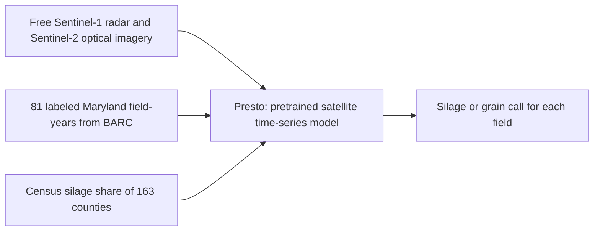
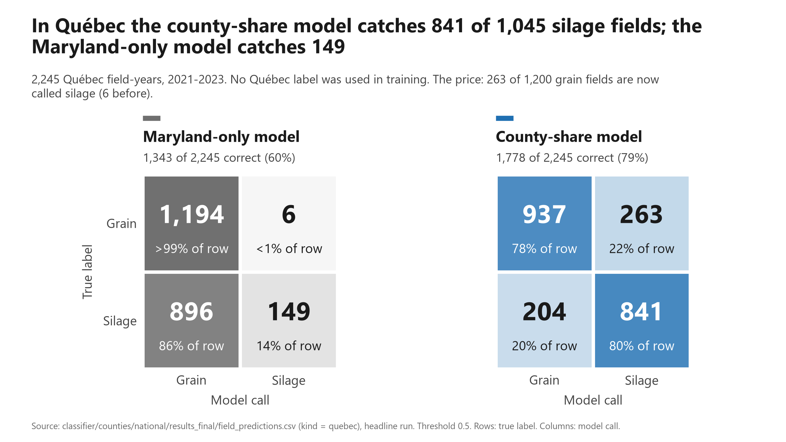

# What it is and who it is for

**A satellite model that tells silage corn from grain corn per field, learned from one research farm's labels plus county statistics that already exist, and it now transfers far better beyond Maryland than the Maryland-only model, though reusing the last Census is still closer on county totals.**

## The problem

- Silage corn is chopped green for animal feed. Grain corn is left to dry and harvested for the kernels. It is the same plant, and the two look alike from space until harvest.
- The public Cropland Data Layer (a USDA NASS crop map) says "corn" without saying which kind.
- The Census of Agriculture counts silage and grain acres per county, and the repo's data holds it for 2012, 2017 and 2022.
- Between Censuses the repo's data holds state-level survey shares only. It also has survey rows for some counties in the Census years; these are left out of the team's county targets.

## What the team built

- **Model:** Presto, a pretrained satellite time-series model from NASA Harvest, run on free Sentinel-1 radar and Sentinel-2 optical imagery.
- **Maryland labels:** fine-tuned on 81 labeled field-years (2017-2020) from BARC, the Beltsville, Maryland research farm whose field records are the labels.
- **The rest of the country:** no new field labels. For 163 sampled counties in 36 states, training makes each county's average prediction match that county's 2022 Census silage share. This is the "county-share model". The "Maryland-only model" is the same network without that step.
- **Why latitude and longitude are fixed:** so a county's location cannot stand in for its silage share.

The chart shows Québec field checks. No Québec label was used in training.

## What works today

| Test | Maryland-only model | County-share model |
|---|---|---|
| Maryland held-out years (2021-2023): field-years right | 41 of 44 | 41 of 44 (same calls) |
| Québec, no Québec label: right | 1,343 of 2,245 (60%) | 1,778 of 2,245 (79%) |
| Québec: silage fields found | 149 of 1,045 | 841 of 1,045 |
| 163 counties, each scored by a model that never saw its state: mean gap from the Census share | 0.248 | 0.139 |
| Same 163 counties: counties in the right silage-share class | 53 of 163 | 97 of 163 |
| 7 counties never trained on: mean gap | 0.339 | 0.127 |

Reading the county rows: the gap is the average distance between the model's county silage share and the Census share, where 0 is perfect. The county estimate here is the share of a county's sampled corn blocks called silage (100 per county; 200 in the 7 counties). The right class means under 5%, 5-40% or 40% and over. Seven counties is a small check. Figures: [numbers.md](numbers.md) sections 1-5.

## Why would USDA use this

The Census gives one silage number per county every five years. The model gives a silage or grain call for every field, every year it has imagery.

Possible users, as potential only and not demonstrated:

- **Crop statisticians:** a field-level, between-Census view to compare with survey estimates.
- **Extension and dairy-feed planning:** where silage was grown last season (the model needs the full year of imagery), as a guide to feed supply.
- **Crop-map producers:** a silage or grain split for the "corn" class of maps such as the Cropland Data Layer.

Reusing the last Census (2017) is still closer on county totals: mean gap 0.082, against 0.138 for the model on the same 163 counties and the same county estimate (mean probability). It also puts more counties in the right class, 125 against 108. So today the model adds the field-level and between-Census view. It does not replace the Census number.

## The promise

The method needs only public imagery and county statistics that already exist. It uses no field labels outside one research farm. Any region with a Census-style county silage share could, in principle, be taught the same way. That is a plausible path to cover areas with no labels, not yet shown beyond the tests above.

## Honest limits

- **Québec:** the price of finding more silage is 263 of 1,200 grain fields called silage (6 before). Those Québec labels are insurance declarations, not harvest records.
- **National total:** the model's national silage share is too high, 0.133 against the Census 0.071.
- **Maryland:** the test is small, 44 field-years, so 41 of 44 has a wide interval (0.818-0.977).
- **Against the baseline:** the county-share model is not shown to beat the Census or the reuse-the-last-Census baseline.

Details: [Limits and promise](04-limits-and-promise.md).

## Read next

[How it works](02-how-it-works.md)
