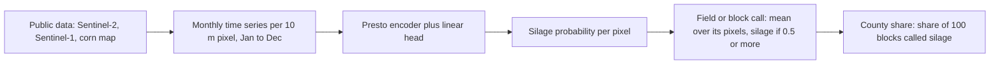
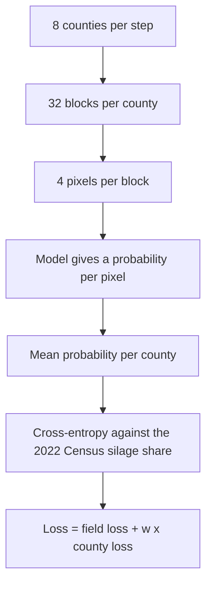
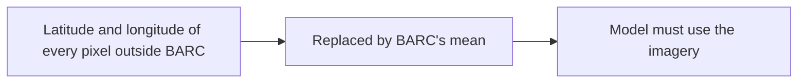

# How it works

**The model reads a year of satellite images for each small patch of corn, scores each patch from 0 to 1 for silage, and learns beyond Maryland from one cheap signal: the Census of Agriculture's silage share for each county.**



Each step in plain words:

- **Pixel series.** For every 10 m pixel, 12 monthly steps. Sentinel-2 (optical) gives the median of clear readings: bands B2-B8, B8A, B11, B12, plus NDVI, a greenness index. Sentinel-1 (radar) gives VV and VH power in dB.
- **Presto.** A small transformer pretrained by NASA Harvest on pixel time series. The team fine-tunes it and adds a linear head.
- **Field call.** A field's probability is the mean over its pixels. Silage is the positive class and the cut is 0.5.
- **Block and county.** Counties have no field outlines, so a county is 100 corn blocks of 90 m. The county estimate is the share of those blocks called silage.

## Data sources

All imagery and maps are public. BARC is the Beltsville, Maryland research farm whose field records are the training labels.

| Source | What it is | Resolution | How obtained | Used for | Known limit |
|---|---|---|---|---|---|
| Sentinel-2 L2A | Optical bands B2-B8, B8A, B11, B12 | 10 m grid, 12 monthly steps | Microsoft Planetary Computer, `presto_pixels.py` | Model input | Presto was pretrained on Level-1C, inputs are Level-2A (effect not measured); months blur the harvest date |
| Sentinel-1 RTC | Radar VV and VH | 10 m grid | Same | Model input | Same monthly blur |
| Cropland Data Layer 2022 (USDA NASS) | Corn map | 30 m | CropScape download | Picks all-corn 90 m blocks (3 x 3 pixels) | Map errors; all-corn blocks favor large fields |
| NASS QuickStats and Census of Agriculture | Harvested acres of grain and silage corn per county | County | `02_QuickStats/` files in the repo | 2022 county target and scoring; 2017 and 2012 as the baseline | Census rows only; one 10 km square stands in for a county; 2022 was a Plains drought year |
| BARC field labels | 125 field-years, 2017-2023 (94 grain, 31 silage) | Field polygons | Official 2021-2023 test labels; 2017-2020 from public farm records | Train on 2017-2020 (81), test on 2021-2023 (44) | One farm; most 2017-2020 labels rest on a planting record only |
| Québec field labels | 2,245 field-years, 2021-2023 (1,045 silage, 1,200 grain) | Parcel polygons | Québec crop-insurance data (FADQ, CC BY 4.0) | Test only; never trained on | Insurance declarations, not harvest records |

## Two training signals

1. **Field loss.** On the 81 labeled Maryland field-years, a pixel-level cross-entropy loss against the field's label, balanced between silage and grain.
2. **County-share loss.** No field labels exist outside Maryland and Québec, but the Census gives each county's silage share. This is learning from label proportions: the model is not told which blocks are silage, only what fraction of a county's corn is. It is pushed until the average of its predictions over a county matches that fraction.



The weight w sets how hard the county signal pulls. At w = 0 the county loss is off: this is the Maryland-only training with location hidden and one seed (gap 0.255; the reported Maryland-only model, with real location and five seeds, scores 0.248). Only BARC labels reach the model as field labels. The 163 training counties are in 36 states, with 100 corn blocks each (16,300).

## Location is hidden



Without this, the model could learn "north means silage" and score well on county shares without looking at crops. The replacement is in `classifier/counties/presto_national.py`, lines 302-304, and applies to the county-share model and the w grid. The reported Maryland-only numbers use real location.

## Choosing the loss weight without peeking

The weight w was chosen from 0, 0.3, 1, 3 and 10 using only data the model never trained on.

- **Five state groups.** Counties were split into 5 groups by state (32, 36, 32, 32 and 31 counties; no state in two groups). Each county was scored by a model that never saw its state.
- **Maryland guard.** Each BARC year 2017-2020 was predicted by a model trained on the other three. A w could lose at most 1 of the 81 calls compared with w = 0 (so 71 or more right). No w lost any.
- **Pick.** Lowest county gap among the w that pass the guard. The gap is the mean absolute difference between the share of blocks called silage and the Census share.

| w | Out-of-fold county gap | Maryland guard, right of 81 |
|---|---|---|
| 0 | 0.255 | 72 |
| 0.3 | 0.166 | 74 |
| **1 (chosen)** | **0.139** | 73 |
| 3 | 0.144 | 77 |
| 10 (added after an early run: exploratory) | 0.151 | 76 |

The headline run is the better of two input windows, January-December or January-October, by the same rule, fixed before either final result: 0.139 against 0.148, so January-December. Two caveats:

- On the mean-probability gap the two are about tied (0.138 against 0.135).
- Earlier runs had already been seen before the rule was fixed. Those runs used Census shares that wrongly included survey rows. None of their numbers are used here.

The county numbers also chose w, so they are slightly optimistic.

## Why these choices

| Choice | Reason |
|---|---|
| County shares as a second target | No field labels exist outside Maryland and Québec; the Census reports silage acres for every county. |
| Start from a pretrained model | In Maryland splits, the same network from random weights did worse (`classifier/presto/README.md`, Results). |
| Hide latitude and longitude | So location cannot stand in for the share. |
| Guard and state-group scoring for w | The weight is picked on data the model did not see, and Maryland must not get worse. |
| Census shares from Census rows only | An early mix-up added 2022 survey rows to Census rows. It was found and fixed before the final runs (`classifier/counties/README.md`, lines 86-87). |
| All-corn 90 m blocks | Blocks avoid field outlines, so any county can be sampled from the corn map alone. |

## Run it yourself

Placeholders: `<repo>` the repo root, `<work-dir>` a scratch folder, `<python>` an interpreter with torch, `<presto-dir>` a checkout of `nasaharvest/presto`, `<common args>` the data paths in the `common=(...)` block of `classifier/counties/launch_runs.sh`.

```bash
<python> classifier/counties/national_counties.py ...         # sample counties and blocks
bash classifier/counties/launch_pulls.sh <workers>            # imagery pull per county, 2022; edit the work folder and interpreter at the top of the script first
<python> classifier/counties/presto_national.py <common args> --presto-dir <presto-dir> --out <work-dir>/results_final
<python> classifier/counties/census_prior.py --runs <work-dir>/results_final ...   # last-Census comparison
<python> classifier/counties/national_metrics.py <work-dir>/results_final          # metrics, CPU only
uv run --no-project --with pandas --with matplotlib --with scikit-learn python -I docs/figures/make_figures.py
```

The last line regenerates the charts. Full arguments for the three national runs are in [launch_runs.sh](../classifier/counties/launch_runs.sh) and each script's docstring; the Maryland-only pipeline is in [the Presto README](../classifier/presto/README.md). The national training runs need a GPU and imagery pulls that are not committed, so they were not rerun for these docs.

## Read next

[Results and evidence](03-results.md)
