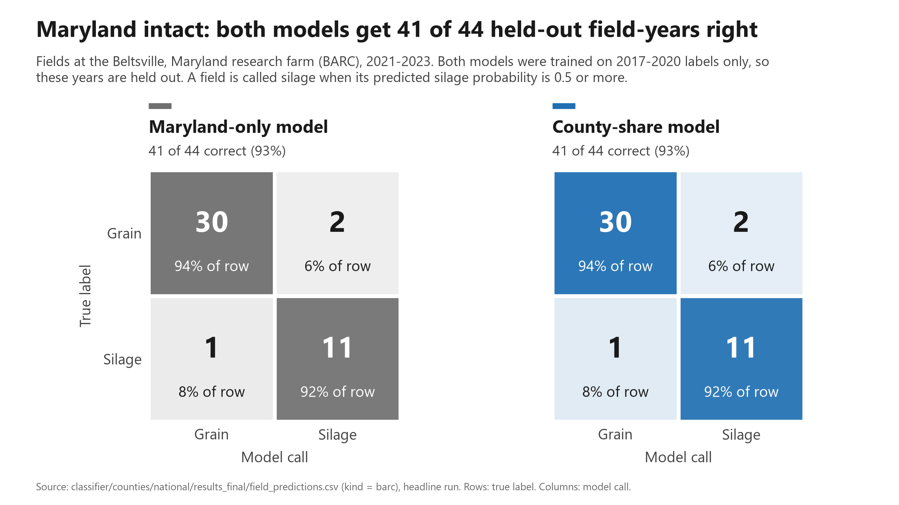
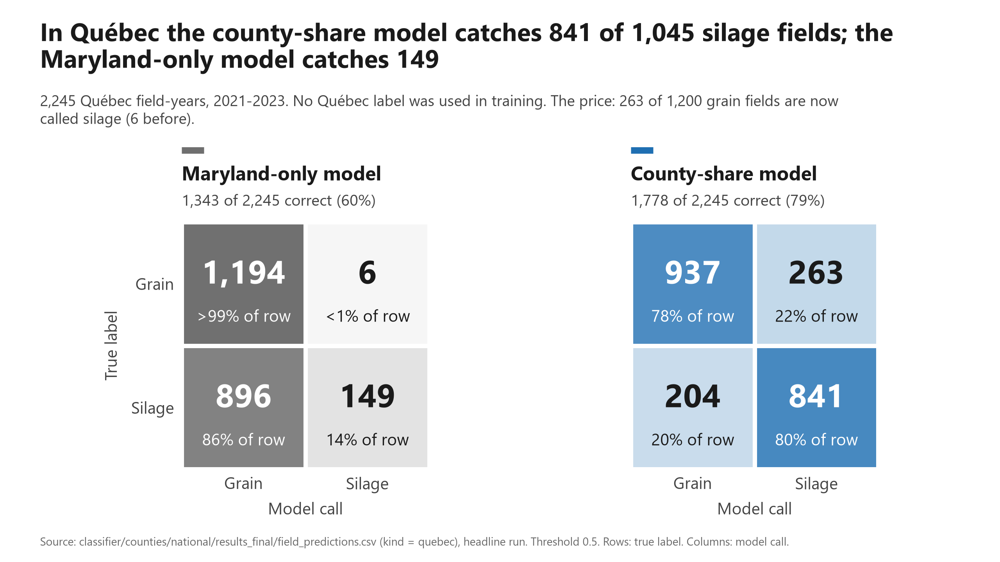
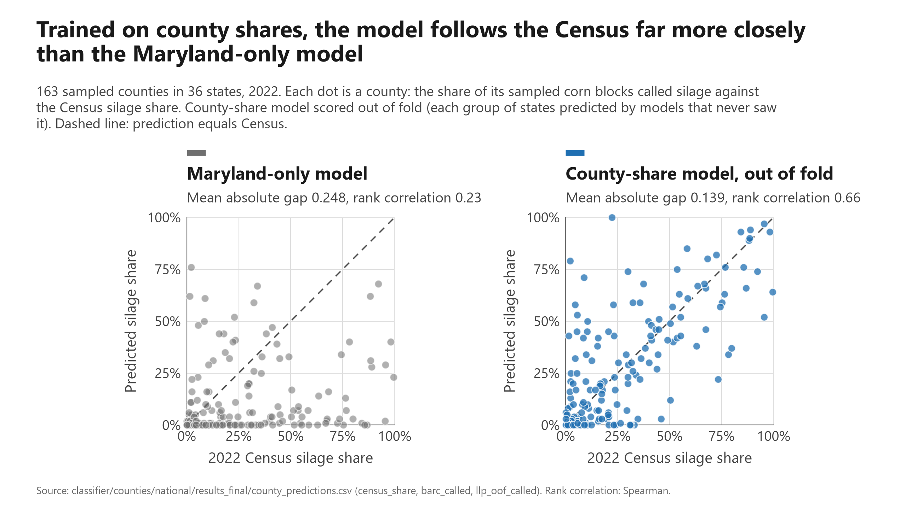
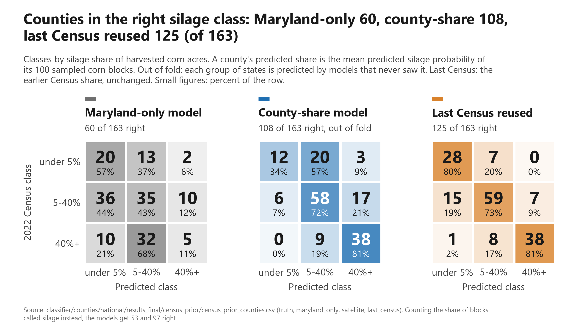
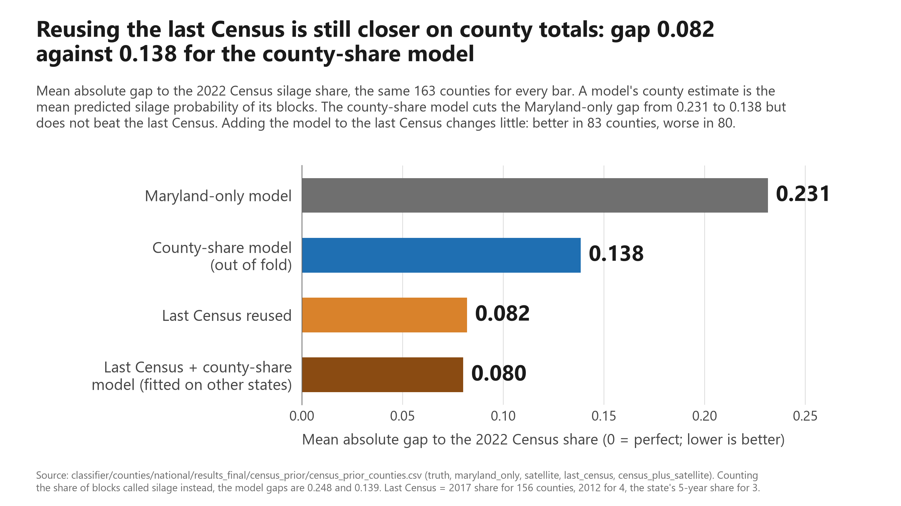
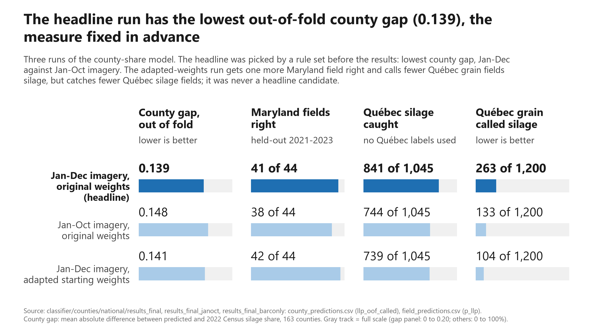

# Results

**The county-share model keeps Maryland intact (41 of 44 held-out field-years) and transfers far better than the Maryland-only model to Québec and to 163 US counties, but reusing the last Census (2017) is still closer on county totals, and the model's national total is too high.**

Two models are compared throughout (see [What it is](01-what-it-is.md)):

- **Maryland-only model:** trained on field labels from BARC, the Beltsville, Maryland research farm.
- **County-share model:** adds the 2022 Census of Agriculture silage share of 163 counties as a training target, with no field label outside Maryland.
- A field is called silage when its probability is 0.5 or more. Every number is in [numbers.md](numbers.md).

## Validation design

| Test | What is held out | What it tells us |
|---|---|---|
| Maryland 2021-2023 | The three newest years | Does the model still work at home, on years it never saw? |
| Québec | A whole region; no Québec label in training | Does it transfer to another place and crop calendar? |
| 163 counties, out of fold | Each group of states, predicted by models that never saw it | Does it follow county silage shares in new states? |
| 7 counties | Counties never used for training or for choosing settings | A small check of county totals (earlier Maryland-only models had been scored on them, so not fully blind) |
| Last Census reused | Nothing to train | The bar a new method has to be compared with |

No random split of fields: nearby fields share management and imagery. Folds hold out years, a region and groups of states.

## Maryland

- **44 field-years:** 2021: 4 silage, 14 grain; 2022: 4 silage, 3 grain; 2023: 4 silage, 15 grain (12 silage, 32 grain).
- **Right per year:** 15/18, 7/7, 19/19. All 44 calls are identical between the two models.
- **Confusion matrix (both models):** silage 11 called silage, 1 called grain; grain 2 called silage, 30 called grain.

Terms: **precision** is the USDA's user's accuracy (of fields called a class, the share truly in it). **Recall** is the producer's accuracy (of fields truly in a class, the share found). **Kappa** is agreement beyond chance: 1 is perfect, 0 is chance level, below 0 is worse than chance.

Precision and recall have no interval in the source files; with 12 silage fields the intervals are wide.

| Measure | Both models |
|---|---|
| Accuracy (95% interval) | 41/44 = 0.932 (0.818-0.977) |
| Silage precision / recall | 0.846 / 0.917 |
| Grain precision / recall | 0.968 / 0.938 |
| Kappa (95%) | 0.832 (0.616-1.000) |
| AUC, ranking quality (95%) | 0.969 (0.903-1.000) Maryland-only; 0.982 (0.938-1.000) county-share |

## Québec

- **Field-years:** 2,245 in 2021-2023: 2021 silage 360, grain 400; 2022: 336, 400; 2023: 349, 400 (1,045 silage, 1,200 grain). No Québec label was used in training.
- **Confusion matrix** (silage called silage / grain, then grain called silage / grain): Maryland-only 149 / 896 and 6 / 1,194; county-share 841 / 204 and 263 / 937.

| Measure | Maryland-only | County-share |
|---|---|---|
| Accuracy (95%) | 1,343/2,245 = 0.598 (0.578-0.618) | 1,778/2,245 = 0.792 (0.775-0.808) |
| Silage precision / recall | 0.961 / 0.143 | 0.762 / 0.805 |
| Grain precision / recall | 0.571 / 0.995 | 0.821 / 0.781 |
| Kappa (95%) | 0.146 (0.123-0.171) | 0.583 (0.550-0.616) |
| AUC (95%) | 0.780 (0.761-0.799) | 0.865 (0.849-0.880) |

**The cost is false silage:** the county-share model calls 263 of 1,200 grain fields silage (21.9%), against 6 (0.5%) for the Maryland-only model.

The Québec sample is 47% silage by design; in the area it was drawn from the real share is about 19%. At that share accuracy is 0.83 for the Maryland-only model and 0.79 for the county-share model, and calling every field grain would score 0.81. So the gain in Québec is in finding silage, not in raw accuracy at the real share.

## 163 counties

Scatter and table below: county estimate is the share of its 100 corn blocks called silage. Truth is the 2022 Census silage share. Each county is predicted by a model that never saw its state group.

| Measure | Maryland-only | County-share |
|---|---|---|
| Mean absolute gap (95%, resampling states) | 0.248 (0.185-0.323) | 0.139 (0.107-0.175) |
| Bias (estimate minus Census) | -0.171 | +0.004 |
| Spearman rank correlation | 0.23 | 0.66 |
| Counties in the right class | 53/163 | 97/163 |
| Weighted kappa (95%) | 0.09 (-0.040-0.265) | 0.58 (0.436-0.700) |

Classes are under 5%, 5-40% and 40% and over (35, 81 and 47 counties). By share of blocks called silage: of 47 counties at 40% or more, the Maryland-only model calls 23 under 5% and the county-share model 1. Of 35 counties under 5%, they call 11 and 15 higher.

This chart uses a different county estimate: the mean probability of the county's blocks. That gives 60 and 108 right (not 53 and 97); the 125 is the last Census. Its cells differ from the 23 / 1 and 11 / 15 above (here 10 / 0 and 15 / 23), so do not compare it with the table above.

## The 7 counties never trained on

200 blocks each, in Maryland, Pennsylvania, New York and Vermont.

| Measure | Maryland-only | County-share |
|---|---|---|
| Mean absolute gap | 0.339 | 0.127 |
| Counties in the right class | 2/7 | 5/7 |
| Spearman (mean probability) | -0.04 | 0.93 |
| Washington, NY (Census 0.759), share called silage | 0.115 | 0.570 |
| Addison, VT (Census 0.921) | 0.210 | 0.780 |
| Queen Anne's, MD (Census 0.013) | 0.220 | 0.120 |

Seven counties is a small check. In the two highest-silage counties (Washington, NY and Addison, VT) both models call too little silage; the county-share model is much closer.

## Honest baseline: reuse the last Census

The last Census is the 2017 share (2012 for 4 counties, the state's 5-year share for 3). It is the same 163 counties and the same truth. County estimate for models: mean probability.

| Estimate | Mean gap | Spearman | Right class |
|---|---|---|---|
| Last Census (2017) reused | 0.082 | 0.90 | 125/163 |
| County-share model | 0.138 | 0.68 | 108/163 |
| Maryland-only model | 0.231 | 0.31 | 60/163 |
| State 2022 survey share for every county | 0.144 | 0.69 | 109/163 |
| Last Census + county-share model | 0.080 | 0.91 | 126/163 |

**The last Census reused is closer than the model.** Adding the model to it gives no measurable gain: better in 83 counties, worse in 80 (Wilcoxon p = 0.67). The model's national total is also too high: 0.133 of US corn acres in silage, against 0.071 in the Census.

## The runs compared

The headline run (January-December imagery, loss weight w = 1) is the one a rule declared before either final result picks: the lowest out-of-fold county gap (0.139 against 0.148 for January-October). The other two are shown for transparency and are mixed, not better:

- **January-October imagery:** 0.148; 38 of 44 in Maryland; 744 of 1,045 Québec silage found; 133 of 1,200 grain called silage.
- **January-December with adapted starting weights:** 0.141; 42 of 44; 739; 104.

Sources: [headline](../classifier/counties/national/results_final/metrics_usda.md), [Jan-Oct](../classifier/counties/national/results_final_janoct/metrics_usda.md), [adapted weights](../classifier/counties/national/results_final_barconly/metrics_usda.md).

## Sources of error

- **Label quality.** BARC is one farm; most 2017-2020 labels rest on a planting record only. Québec labels are insurance declarations, not harvest records.
- **Small Maryland test.** 44 field-years, 12 silage: one field moves recall by 8 points.
- **One 10 km square per county.** The model sees 100 corn blocks per county; the Census covers the whole county. The Census share is of harvested acres; blocks are all-corn 90 m squares, which favor large fields.
- **Settings chosen on the same numbers.** The out-of-fold county numbers also chose w, so they are slightly optimistic.
- **One year of counties.** County training and scoring use 2022 imagery only.

## Read next

[Limits and promise](04-limits-and-promise.md)
