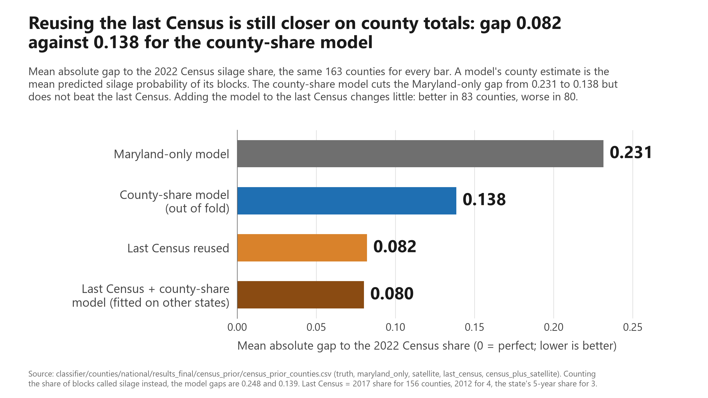

# Limits and promise

**Today the county-share model is not better than the last Census on county totals, its national total is too high, and it calls too many Québec grain fields silage; it is still worth building on because it transfers far better than the Maryland-only model, keeps Maryland intact, and gives an answer per field where the Census gives none.**

*Mean gap to the 2022 Census silage share, same 163 counties in every bar (the model's county estimate is the mean probability of its blocks, scored on counties of states it never saw). The county-share model cuts the Maryland-only gap from 0.231 to 0.138. The last Census reused (the 2017 share) is at 0.082. Adding the model to it gives 0.080.*

Terms: the **Maryland-only model** learns from field labels of BARC, the Beltsville, Maryland research farm. The **county-share model** adds the Census silage share of 163 counties as a training target, with no field label outside Maryland. Numbers come from [numbers.md](numbers.md).

## Where it fails today

### County totals: the last Census is closer
The last Census reused misses by 0.082 on average. The county-share model misses by 0.138 (like-for-like, section 6 of numbers.md). The Census is closer in 116 of 163 counties (exploratory count). The right class (under 5%, 5-40%, 40% and over) is hit in 125 counties by the Census and 108 by the model. In practice: for a county total, look up the last Census first.

### The national total is too high
The model puts the US silage share of corn acres at 0.133. The Census says 0.071, so the model's total is about 1.9 times the Census. It over-calls silage in low-silage counties, which hold most corn acres: of 35 counties under 5% silage, it calls 15 higher (the Maryland-only model, 11). The Maryland-only total of 0.072 looks right only because its errors cancel. In practice: do not quote the model's national total.

### Québec: false silage
- No Québec label was used. The model finds 841 of 1,045 silage fields (the Maryland-only model, 149).
- It calls 263 of 1,200 grain fields silage (21.9%; the Maryland-only model, 6).
- The Québec sample is 47% silage; the area is 19%. At 19% the county-share model scores 0.79 accuracy; calling every field grain scores 0.81. The gain is in finding silage, not in raw accuracy.
- The Québec labels are insurance declarations, not harvest records.

### The Maryland test is small
There are 44 field-years (12 silage, 32 grain) from 2021-2023. One field-year moves silage recall by 8 points. 41 of 44 is right, accuracy 0.932 (95% interval 0.818-0.977). The county-share model makes the same 44 calls as the Maryland-only model, so Maryland is kept, not improved.

### One year, one square, one farm
- County results use 2022 imagery only. 2022 was a drought year in the Plains, where some grain corn was chopped for silage.
- One 10 km square (100 corn blocks of 90 m) stands in for a whole county. The corn map has its own errors, and all-corn blocks favor large fields.
- County totals cannot show which blocks are wrong: over-calls and under-calls cancel.
- All training labels and the official test come from BARC. Most 2017-2020 training labels rest on a planting record only.
- Imagery is monthly, so a cut on August 2 and one on August 30 look the same.
- Seven counties never trained on are a small check (5 of 7 in the right class).

## Uncertainty

| Result | Value | 95% interval |
|---|---|---|
| Maryland accuracy, 44 field-years | 0.932 | 0.818-0.977 |
| Maryland kappa (agreement beyond chance) | 0.832 | 0.616-1.000 |
| Québec accuracy, 2,245 field-years | 0.792 | 0.775-0.808 |
| County gap, county-share model | 0.139 | 0.107-0.175 |
| County gap, Maryland-only model | 0.248 | 0.185-0.323 |
| County weighted kappa, county-share model | 0.58 | 0.436-0.700 |

The county intervals come from resampling states, so they reflect state-to-state spread. These two county gaps use the share of blocks called silage; the 0.138 above uses the mean probability. The out-of-fold numbers also chose the loss weight w (how hard the county target pulls), so they are slightly optimistic.

## What was tried and did not help
- Last Census plus the model: gap 0.080 against 0.082, better in 83 counties and worse in 80 (p = 0.67). No measurable gain.
- January-October imagery instead of January-December: out-of-fold county gap 0.148 against 0.139, and 38 of 44 in Maryland against 41.
- Adapted starting weights: more Québec fields right (1,835 against 1,778) but fewer silage fields found (739 against 841). Mixed, not a better model.
- Recalibrating the model's county estimate on other states' Census shares: gap 0.145 against 0.138, 104 against 108 counties in the right class. No gain ([source table](../classifier/counties/national/results_final/census_prior/census_prior.md)). This tested the county estimate, not the field threshold in item 1 below.

## Realistic path to real-world use
These are proposals, not results.
1. **Lower the false-silage rate outside Maryland** (Québec, low-silage counties). Calibrate the 0.5 threshold per region using Census shares, which needs no field label.
2. **Use the last Census as the county total and the model for the change and for fields.** This addresses the county-total gap. A fitted blend of the 2017 share and the model was tried and gave no measurable gain, so test a direct change-from-last-Census estimate before relying on it. The repository does not record that estimate as tried.
3. **Add a few field labels from dairy regions** (Québec, New York, Vermont) to address the Maryland-only labels.
4. **Add years and more blocks per county** to address the one-year, one-square limit.
5. **Score against field labels in a second US region** to address the small, single-farm test.

## What would make it deployable
- It matches or beats the last Census on county totals (gap near 0.082 or lower), and the national total lands near the Census.
- The false-silage rate outside Maryland falls well below Québec's 21.9%, with raw accuracy above the call-everything-grain line at the real silage share.
- A labeled check in a second US region holds up, with intervals that do not reach the Maryland-only result.

See also: [county method and limits](../classifier/counties/README.md), [Maryland validation](../VALIDATION.md).

## Read next

[Numbers sheet](numbers.md): every number, with its source. Copy numbers for slides from there.
