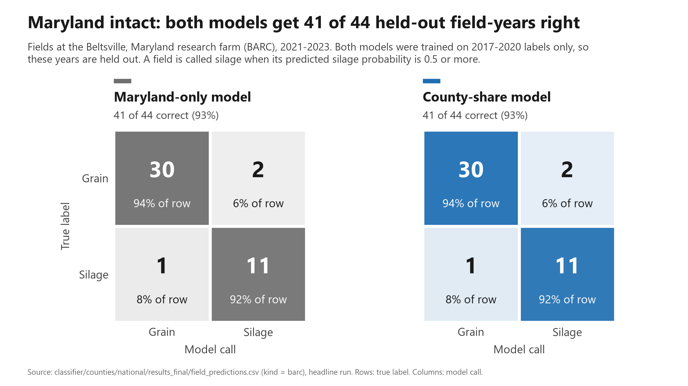
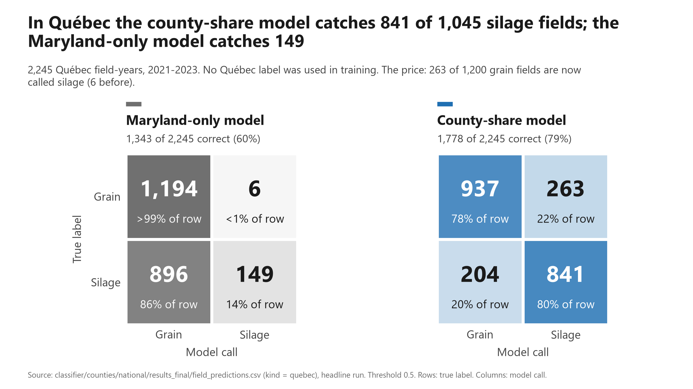
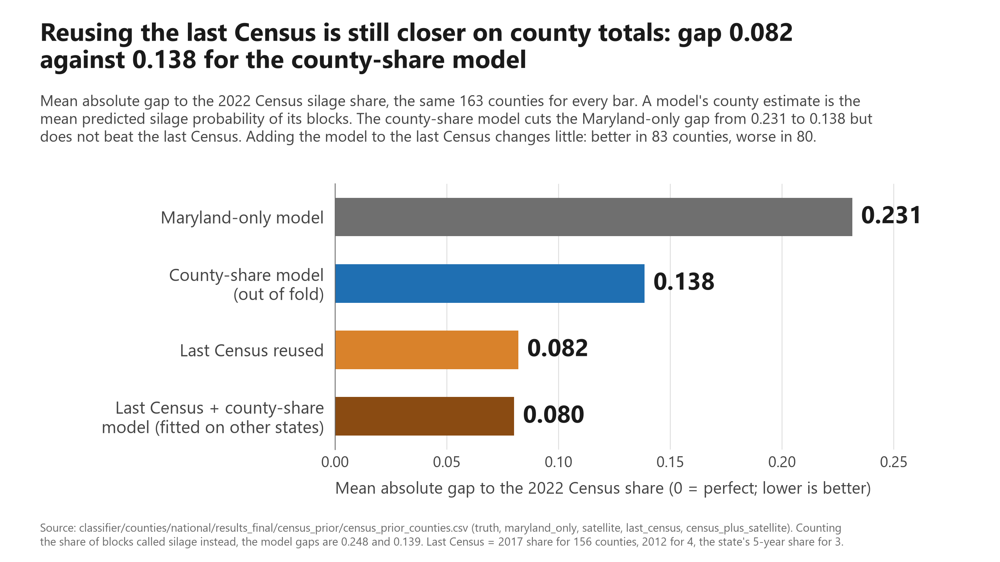

# Silage corn or grain corn, from public satellite data

**Public satellite data can tell silage corn from grain corn field by field, and a county-share model extends this beyond Maryland, but the last Census is still closer on county totals.**

Silage corn and grain corn look alike from space until harvest. The Census of Agriculture counts silage acres per county every five years. The team built a satellite model that makes a silage or grain call for each field.

- **What it learns from:** 81 labeled field-years from BARC, the Beltsville, Maryland research farm whose field records are the labels, and the Census silage share of 163 counties.
- **Strongest result:** the county-share model finds 841 of 1,045 Québec silage fields with no Québec label, against 149 for the Maryland-only model, and keeps Maryland at 41 of 44.
- **Honest limit:** reusing the last Census (2017) is still closer on county totals, and the model's national total is too high.

## Read in this order (about 15 minutes)

1. [What it is and who it is for](01-what-it-is.md): the problem, the idea and the results in brief (4 min)
2. [How it works](02-how-it-works.md): the satellite data, the model and the two training signals (4 min)
3. [Results and evidence](03-results.md): Maryland, Québec, the 163 counties and the last-Census baseline (4 min)
4. [Limits and promise](04-limits-and-promise.md): where it fails today and the realistic next steps (2 min)
5. [Numbers sheet](numbers.md): every number with its source. Copy numbers for slides from here (1 min)

## The pitch in six beats

| Beat | One line to say | Figure to show | Detail page |
|---|---|---|---|
| The problem | Silage and grain corn look alike from space, and the Census gives one number per county every five years | None (text page) | [01](01-what-it-is.md#the-problem) |
| The idea | Census county silage shares act as free training labels outside Maryland | None (diagram on page) | [02](02-how-it-works.md#two-training-signals) |
| It keeps Maryland intact | The county-share model makes the same 44 Maryland calls as the Maryland-only model, 41 of 44 right |  | [03](03-results.md#maryland) |
| It transfers | In Québec, with no Québec label, it finds 841 of 1,045 silage fields instead of 149 |  | [03](03-results.md#québec) |
| The honest baseline | The last Census is still closer on county totals, and the model's national total is too high |  | [03](03-results.md#honest-baseline-reuse-the-last-census) |
| The promise and next step | It needs only public imagery and existing county statistics, so it could reach regions with no labels | None (text page) | [04](04-limits-and-promise.md#realistic-path-to-real-world-use) |

## Figures

Six charts in [figures/](figures/) (PNG and SVG):

- `cm_maryland`: Maryland held-out years, both models make the same 41 of 44 calls.
- `cm_quebec`: Québec field checks, with no Québec label in training.
- `county_class_matrices`: counties in the right silage-share class, for both models and the last Census.
- `county_2x2`: the same counties in two classes, under 40% silage or 40% and over (exploratory).
- `pred_vs_census_scatter`: each of the 163 counties, estimate against the Census share.
- `variants_bar`: the three runs of the county-share model; the headline run has the lowest out-of-fold county gap.
- `last_census_comparison`: mean gap to the Census share, last Census reused against the models.

Regenerate them with:

```bash
uv run --no-project --with pandas --with matplotlib --with scikit-learn python -I docs/figures/make_figures.py
```

Counts and gaps in these pages were recomputed from the committed CSVs by an independent check; the 95% intervals are copied from the committed metrics files.

## Read next

[What it is and who it is for](01-what-it-is.md)
