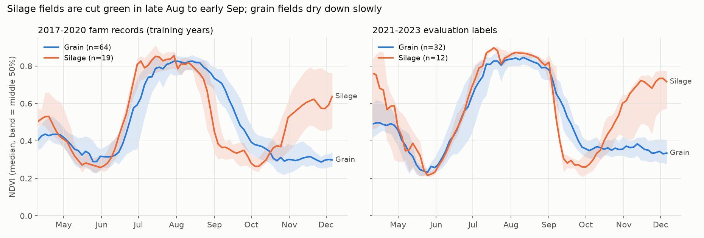
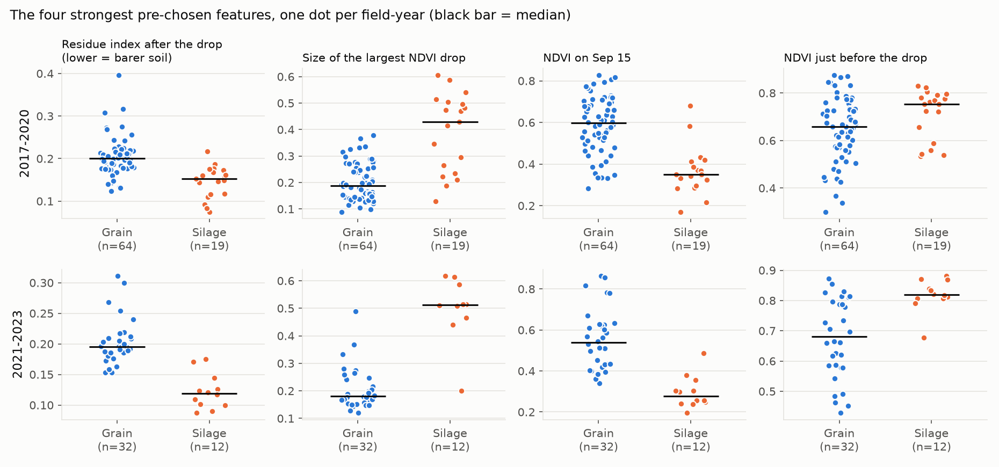

# Grain vs silage from public satellite data (BARC, Maryland)

**Claim:** at BARC, silage corn is cut green in late August to early September, which leaves a sharp NDVI drop
and a bare, low-residue field; grain corn dries down slowly and leaves residue. Four pre-chosen features built
from Sentinel-2 + Landsat capture this and separate the two classes on held-out years.

Everything here reproduces with one command (see [Reproduce](#reproduce)). Full numbers:
[`results/report.md`](results/report.md). Notes for an AI assistant picking this up: [`CLAUDE.md`](CLAUDE.md).

## Results at a glance

Test set: the 44 labeled 2021-2023 field-years (32 Grain, 12 Silage) unless stated. P = precision, R = recall.

| Validation | Trained on | Model | Correct | Silage P / R | Grain P / R | ROC-AUC |
|---|---|---|---|---|---|---|
| Leave one year out, 2021-2023 | the other two years | Logistic, 5 hypothesis features | 42/44 | 0.92 / 0.92 | 0.97 / 0.97 | 0.96 |
| Leave one year out, 2021-2023 | the other two years | Random forest, all features | 43/44 | 1.00 / 0.92 | 0.97 / 1.00 | 0.95 |
| Same, strict (test-year fields removed from training) | the other two years | Logistic | 42/44 | 0.92 / 0.92 | 0.97 / 0.97 | 0.96 |
| **Out of time** | **2017-2020 farm records only (83)** | **Logistic** | **39/44** | **0.73 / 0.92** | **0.97 / 0.88** | **0.98** |
| **Out of time** | **2017-2020 only** | **Random forest** | **41/44** | **0.85 / 0.92** | **0.97 / 0.94** | **0.95** |
| Out of time, strict | 2017-2020 fields never seen in 2021-2023 (53) | Logistic | 40/44 | 0.79 / 0.92 | 0.97 / 0.91 | 0.98 |
| Leave one year out, all seven years (test = 127 field-years, 31 silage) | the other six years | Logistic | 113/127 | 0.76 / 0.81 | 0.94 / 0.92 | 0.94 |

Baselines on the same 44: "Silage if Central Farm" 29/44; one cut on the NDVI-drop date 29/44; the best single
rule chosen on 2017-2020 (`ndti_sep15 < 0.225`) 35/44.

Silage recall 11/12 has a 95% Wilson interval of 0.65-0.99; grain recall 31/32 has 0.84-0.99. With 12 silage
test cases, one error moves silage recall by 8 points.





## Hypotheses

Stated before modelling, from the challenge statement and agronomy:

1. **Timing:** silage is cut earlier (late Aug to early Sep) than grain is harvested (late Sep to Nov).
2. **Cut green:** silage is cut while the canopy is still green, so NDVI falls from a high value in one step;
   grain loses greenness gradually as it dries down.
3. **Residue:** silage harvest removes the whole plant, leaving bare soil (low NDTI); grain leaves stover
   (higher NDTI).

## Data (all public)

| Source | Use | Access |
|---|---|---|
| Sentinel-2 L2A (10-20 m, tile 18SUJ) | Optical time series | Planetary Computer `sentinel-2-l2a` via `preprocessing/loader.py` |
| Landsat 8/9 Collection 2 Level-2 (30 m) | Optical time series, fills S2 gaps | Planetary Computer `landsat-c2-l2` |
| Daymet daily weather (1 km) | Growing degree days | ORNL single-pixel API |
| BARC evaluation polygons + labels | Test set: 44 labeled field-years, 2021-2023 | `04_Evaluation/BARC_Corn.2021-2023.gpkg` |
| Kraatz BARC farm records + outlines (CC-BY-4.0) | Training labels 2017-2020; 2021 harvest dates for checking | Zenodo [8087301](https://doi.org/10.5281/zenodo.8087301), downloaded and md5-checked by `reproduce.py` |

Each field is shrunk 10 m inward; clouds are masked per pixel (S2 SCL 4-7, Landsat QA bits 0-5); a reading
counts only when at least 60% of the field is clear. Landsat is shifted onto the Sentinel-2 scale per year
(median same-day difference over all fields, no labels used) and isolated one-date NDVI dips (missed clouds)
are dropped. Details: `preprocessing/README.md`.

## Features (one row per field-year)

| Feature | Definition | Hypothesis |
|---|---|---|
| `drop_doy` | Day of year in the middle of the largest NDVI fall between consecutive readings after the summer peak (gap at most 20 days) | 1 |
| `drop_size` | Size of that fall | 2 |
| `ndvi_pre_drop` | NDVI just before that fall | 2 |
| `ndvi_sep15` | NDVI interpolated to Sep 15 | 1 |
| `ndti_post_drop` | Median NDTI (SWIR1 vs SWIR2 tillage index) 5-40 days after the fall | 3 |
| also | `t_below_0.3...0.6` (sustained crossing dates), NDVI/NDTI/NDMI on fixed dates, green-up date, growing degree days, post-cut `regrowth` | exploratory |

The logistic regression uses only the five hypothesis features above. The random forest uses all features.

## Validation design

The 2021-2023 labels are the test set. Splits, from weakest to strongest:

1. **Leave one year out (2021-2023):** train on two years, test on the third.
2. **Strict:** same, and every field that appears in the test year is also removed from training.
3. **Train on 2017-2020, test on 2021-2023:** labels from the Kraatz farm records only, no 2021-2023 data in
   training. This is the out-of-time test.
4. **Leave one year out over all seven years.**

The challenge asks to avoid random field splits; nothing here uses one. A spatial holdout is not yet possible:
11 of the 12 silage field-years are on Central Farm.

## What the results show

- **The signal is strong and simple.** Single features separate the classes almost completely on 2021-2023:
  residue after the drop (AUC 0.98), drop size (0.96), NDVI on Sep 15 (0.96). They hold within Central Farm
  alone (0.97 or better), so they are not just picking up which farm a field is on. The one East Farm silage
  field (5-8, 2022) is predicted correctly.
- **The weights agree across periods.** Logistic weights on standardized features (a positive weight pushes
  toward silage):

  | Feature | Fit on 2021-2023 | Fit on 2017-2020 |
  |---|---|---|
  | `ndti_post_drop` (residue) | -1.00 | -1.28 |
  | `drop_size` | +0.82 | +1.02 |
  | `ndvi_sep15` | -0.72 | -0.72 |
  | `ndvi_pre_drop` | +0.56 | -0.31 |
  | `drop_doy` | -0.11 | -0.89 |

- **Ranking transfers better than the cutoff.** Trained on 2017-2020, the model still ranks 2021-2023 fields
  almost perfectly (AUC 0.98), but its 0.5 cutoff calls 2-4 grain fields silage (two of the logistic model's
  four sit at p = 0.51-0.52). The out-of-time accuracy (39-41/44) is the honest headline, not 43/44. The one
  East Farm silage field (5-8, 2022) is caught here too (p = 0.98).
- **Per held-out year (seven-year split):** 2017 23/24, 2018 14/17, 2019 19/24, 2020 17/18, 2021 17/18,
  2022 6/7, 2023 17/19.
- **The NDVI drop dates the silage cut, not the grain harvest.** Against 16 farm-record harvest dates from
  2021, the drop falls within 2 days of the cut for 2 of 3 silage fields. For grain it falls a median 34 days
  before harvest, because it captures dry-down. Do not call `drop_doy` a harvest date for grain.

### Where it fails

| Field-year | Label | What the satellite shows | Likely reason |
|---|---|---|---|
| 2019 Central Farm 1-14B, 2-32A (and 1-14D, East 5-2A, Linkage EB-3) | Grain | Early, fairly sharp drop around Aug 21-30 | Farm records show all 2019 grain harvested Sep 10-30 (these fields Sep 10-20), much earlier than 2021 (Sep 20 to Nov 15); early grain looks like silage on timing alone |
| 2021 Central Farm 4-7 | Silage | Slow dry-down, residue left | Farm record: cut **Nov 4**, very late for silage. The method detects an early green cut, not silage as such |
| 2022 Central Farm 2-32B | Grain | Sharp drop on Sep 5 from NDVI 0.83 | Looks like an early green cut; worth checking the label |
| 2023 East Farm 5-21, 5-40 | Grain | Drop around Sep 4, low residue index | Borderline (p = 0.6-0.75) |
| 2017-2020 silage on planting records only (1-15, 1-14B/D, 4-25, APU 1-98) | Silage | Grain-like | Planting records state the plan, not what was harvested; possible label noise |

Full list with feature values: `results/report.md` and `results/loyo7_predictions.csv`.

## Is it promising?

Yes, with clear limits.

**For:** the separation comes from a few interpretable, pre-stated features, not from model tuning. A logistic
regression on five features does as well as a random forest on all of them. It survives the hardest split
available (train 2017-2020, test 2021-2023: 39-41/44, AUC 0.95-0.98), using different label sources (farm
records vs the challenge labels), and the learned weights point the same way in both periods.

**Against:**

- Small test set: 12 silage field-years.
- One site, one management team. BARC cuts silage green in late August to early September, and those fields
  usually green up again afterwards (probably a cover crop). The method learns that practice, so a late silage
  cut (4-7, 2021) or an early grain harvest (2019) fools it.
- The fall regrowth signal (AUC 0.99) is probably a BARC cover-crop habit. It is kept out of the main model on
  purpose.
- No spatial holdout is possible: 11 of 12 silage field-years are on Central Farm.

**Bottom line:** a strong, transparent baseline for BARC. Transfer to other farms and regions is untested.

## Reproduce

From the repository root (Windows PowerShell or bash; Python 3.12 tested):

```bash
uv venv .venv
uv pip install --python .venv -r research/grain_vs_silage/requirements.txt
.venv/Scripts/python research/grain_vs_silage/reproduce.py       # macOS/Linux: .venv/bin/python
```

`reproduce.py` downloads the Kraatz files from Zenodo, builds the 2017-2020 field-years, pulls imagery and
weather for both field sets (skipped when `data/series_barc.parquet` and `data/series_kraatz_2017_2020.parquet`
already exist), then writes everything in `results/`. The two imagery pulls take roughly 10-30 minutes each,
depending on network. Use `--analysis-only` to re-run just the analysis and figures (seconds), `--workers 4` if
many scene-days fail, and `--force-pull` to re-pull.

## Files

| Path | What it is |
|---|---|
| `reproduce.py` | One-command pipeline |
| `kraatz_fields.py` | Builds the 2017-2020 training field-years and the 2021 harvest-date records |
| `grain_silage.py` | Features and every validation; writes `results/` |
| `make_figures.py` | The two figures |
| `results/report.md` | Full output: offsets, univariate table, confusion matrices, per-year results, misclassified field-years, harvest-date check |
| `results/univariate_separation.csv` | AUC of every feature, overall, per year and within Central Farm |
| `results/loyo_predictions.csv`, `results/train1720_test2123_predictions.csv`, `results/loyo7_predictions.csv` | Per-field-year predictions for each split |
| `results/features_all_field_years.csv`, `results/features_2017_2020.csv` | The feature tables (iterate on models without re-pulling imagery) |
| `results/scores_all_field_years.csv` | Silage probability for all 249 field-years; only meaningful where the field was corn |
| `results/harvest_date_check.csv` | Detected NDVI-drop dates vs farm-record harvest dates, 2021 |
| `../../preprocessing/loader.py` | Shared loader; `--fields` and `--cell-m` were added for this work |

## Next steps

Roughly in order of expected value:

1. **Year-relative timing.** Express `drop_doy` and `ndvi_sep15` relative to that year's median over all corn
   field-years, or in growing degree days since green-up. This targets the cutoff drift between periods and the
   2019 early-grain errors.
2. **Residue that does not depend on timing.** Silage removes the whole plant even when it is cut late. Look at
   NDTI and SWIR in the first clear image after the drop, per sensor, and at Sentinel-1 VH/VV (standing stover
   vs bare soil, and it sees through cloud). Planetary Computer `sentinel-1-rtc` covers BARC with 43-47 dates a year.
3. **Calibrate instead of using 0.5.** Choose the cutoff on the training years by balanced accuracy, or report
   probabilities with an "uncertain" band (for example 0.35-0.65) for manual review.
4. **Label noise.** Re-run training on harvest-record labels only (2019-2020) and compare with planting-record
   labels (2017-2018). Check 2-32B (2022) and the planting-record silage fields listed above.
5. **More field-years.** 52 Kraatz field-years were dropped because their sub-fields (1-7A to 1-7F and so on)
   have no polygon. Drawing those sub-fields, or matching the farm-database split rows, would add data.
6. **Test outside BARC.** No public field labels exist elsewhere, but county silage acres from NASS (Census
   2017 and 2022, `02_QuickStats/`) can check predicted silage share on Crop Sequence Boundaries fields in
   dairy counties.
7. **Label the unlabeled field-years.** That needs a corn mask: CDL 2022-2023 (CropScape was down; NASS
   national zips are 2 GB each). `results/scores_all_field_years.csv` already has silage probabilities for
   all 249 field-years, but they are meaningless for non-corn fields.
